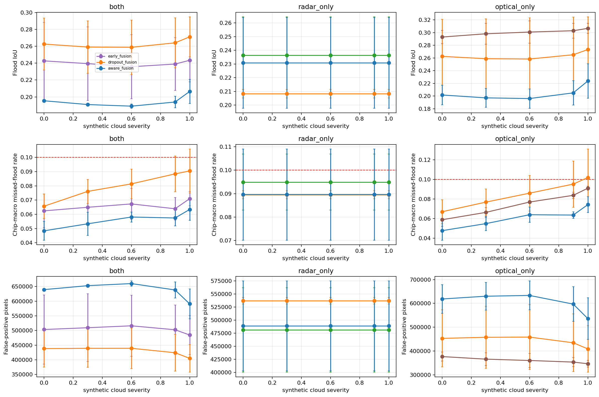
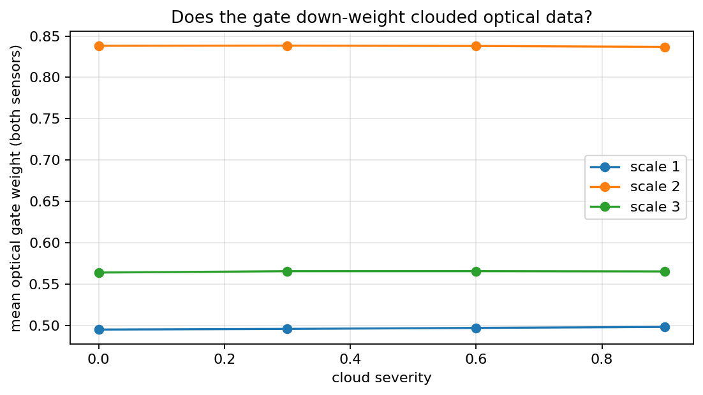

# 🌊 FloodSense — Flood Mapping That Still Works Under Cloud

[](https://github.com/<your-user>/floodsense-demo/actions)
  

A research demo of a **sensor-aware fusion U-Net** that maps floods from Sentinel-1 radar (VV, VH) and Sentinel-2
optical (13 bands), keeps working when either sensor is missing, and picks a **per-sensor-state threshold by
chip-level conformal risk control** to target a chosen missed-flood level. Dataset: Sen1Floods11 (128 × 128 resized chips).

> ⚠ **Research demonstration only — NOT an operational flood-warning or decision-making tool.**

**🔗 Live demo:** _add your Streamlit Community Cloud URL here_ &nbsp;|&nbsp; **📓 Training notebook:** [`notebooks/floodsense_training.ipynb`](notebooks/floodsense_training.ipynb)

<!-- Replace with real screenshots (docs/screenshots/) -->
| Predict | Results panel | Results page |
|---|---|---|
| _docs/screenshots/predict.png_ | _docs/screenshots/results.png_ | _docs/screenshots/results_page.png_ |

## Try it in 60 seconds

```bash
git clone https://github.com/<your-user>/floodsense-demo.git && cd floodsense-demo
python -m venv .venv && source .venv/bin/activate            # Windows: .venv\Scripts\activate
pip install torch --index-url https://download.pytorch.org/whl/cpu   # CPU build (smaller)
pip install -r requirements.txt
streamlit run app.py
```

Then on the page: **Predict → pick a demo scene → Predict**, or switch *Scene source* to **Upload your own** and try the
bundled sample GeoTIFF pair.

## What you can do in the app

| | |
|---|---|
| 🖼 **Demo scenes** | 9 pre-selected Sen1Floods11 chips (with ground truth) incl. held-out Bolivia scenes. |
| 📤 **Upload your own** | Sen1Floods11-style **GeoTIFFs** (`*_S1Hand.tif` + `*_S2Hand.tif`, optional `*_LabelHand.tif`) or a **.npz** chip; radar, optical or both. See [docs/DATA_FORMATS.md](docs/DATA_FORMATS.md). |
| 🛰 **Sensor states** | Both sensors / radar only / optical only — missing sensors get exactly zero weight. |
| ☁ **Synthetic cloud** | A severity slider (0–1) degrades the optical input; radar-only is, by construction, unaffected. |
| 🎯 **Missed-flood target** | 5 % / 10 % / 20 %, mapped to the calibrated threshold of the chosen sensor state. |
| 🔍 **Explanations** | Probability map, calibrated flood map, error map (with labels), gate weights ("what the model trusted"), side-by-side sensor comparison, plain-language summary. |
| 📊 **Results page** | Cloud-robustness curves, main evaluation, ablations, reliability diagrams from the training run. |
| 🕘 **History** | The last 20 predictions, re-openable. |

Without a label file, an uploaded scene gets the flood map, area estimate and sensor comparison but **no IoU / missed-flood
numbers** (there is nothing to compare against); the app says so explicitly.

<p align="center">
  
  
</p>

## Repository layout

```text
floodsense-demo/
├── app.py                      Streamlit entry point (page assembly only)
├── src/
│   ├── model.py                SensorAwareFusionUNet (verbatim from the notebook)
│   ├── cloud.py                synthetic cloud simulator (verbatim; base seed 12345)
│   ├── uploads.py              GeoTIFF / .npz → model-ready chip (torch-free, same preprocessing as training)
│   ├── inference.py            model loading, prediction, thresholds, analysis
│   ├── metrics.py              IoU / missed-flood / false-alarm on valid pixels
│   ├── ui.py, styles.css       page sections and styling
│   └── placeholders.py         synthetic stand-in assets for development/CI only
├── assets/
│   ├── models/aware_fusion.pt  trained weights (seed 0, 443,719 parameters)
│   ├── thresholds.json         CRC thresholds per target × sensor state
│   ├── manifest.json, model_card.json
│   ├── demo_chips/*.npz        pre-processed demo chips   ·   thumbs/*.png  gallery thumbnails
│   ├── sample_tiffs/*.tif      two raw Sen1Floods11 GeoTIFF pairs for the upload demo
│   └── results/                training / evaluation CSVs and figures shown on the Results page
├── notebooks/                  training & evaluation notebook (Kaggle)
├── tests/                      pytest suite (model, assets, uploads, inference, app)
├── docs/                       DATA_FORMATS.md, screenshots/
└── .github/workflows/ci.yml    runs the tests on CPU PyTorch
```

## Tests

```bash
pytest -q
```

Covers: strict weight loading; radar-only output bit-identical across cloud levels; optical-only invariant to the radar
array; gate weights sum to 1 with exactly zero for a missing sensor; all demo chips load with the documented shapes and are
not blank; GeoTIFF/npz parsing, error handling and parity of the NumPy resize with PyTorch's; prediction on uploaded scenes
in every sensor state; an end-to-end run of the Streamlit page.

## Deployment (Streamlit Community Cloud)

1. Push the repo to GitHub and choose it on share.streamlit.io (branch `main`, main file `app.py`).
2. To avoid the large CUDA build of PyTorch, put `--extra-index-url https://download.pytorch.org/whl/cpu` on the first line
   of `requirements.txt`.
3. All assets together are about 17 MB; Git LFS is only needed if you add files above 50 MB.
4. Uploads are limited to 100 MB per file (`.streamlit/config.toml`).

## Regenerating the assets

`assets/` is the `app_assets/` export of the training notebook (run mode `one_day`, 3 seeds; the app uses seed 0's
`aware_fusion`). The notebook's deployment cell (section 22) writes `fusion_deploy.pt` plus two raw test chips; the
demo-chip `.npz` files, thumbnails, thresholds and results tables come from the export; the `.npz` chip format is documented in `docs/DATA_FORMATS.md`.
`src/model.py` and `src/cloud.py` are copied verbatim from the notebook, so cloud corruption in the app is identical to evaluation.

## Limitations and honesty notes

* Chips are 128 × 128 resizes of Sen1Floods11 scenes. Clouds are a **synthetic stress test**, not real atmosphere.
* The missed-flood target uses **chip-level conformal risk control**: it bounds the *expected per-chip missed-flood fraction
  over flood-containing chips that are exchangeable with the calibration chips*. It is **not** a per-pixel, per-image or
  per-event guarantee, may be exceeded on individual scenes, and is **not expected to hold under distribution shift** (e.g. the
  held-out Bolivia scenes — or **any file you upload**). Scenes with no flood have an undefined missed-flood rate.
* Controlling the missed-flood rate comes at the cost of more false alarms; the Results page shows the IoU and
  false-positive trade-off for every threshold rule.
* The demo scenes were hand-picked to illustrate behaviour; they are not representative of average performance — use the
  Results page for that.
* Uploaded rasters must follow the Sen1Floods11 conventions (band order, dB, reflectance × 10000); the app checks the
  obvious mistakes but cannot verify the processing level of your data.
* Area values are approximate. Trained on Sen1Floods11 only; no Bangladesh validation.
* Every metric shown comes from the provided assets or is computed live; nothing is invented.

## License

MIT. Sen1Floods11 data remain under their own license — see the dataset's page; the two sample GeoTIFF pairs are Sen1Floods11 test chips.
